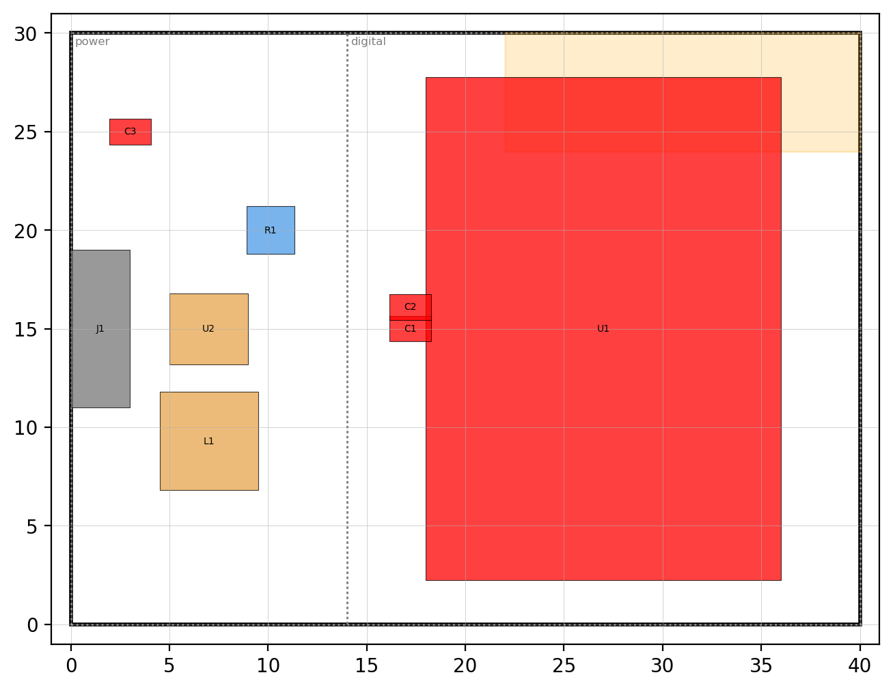

# pcb-layout-design

**A PCB layout skill for AI coding agents that checks its own work.** It turns datasheet-style block rules into numbers,
runs a deterministic placement checker before any coordinate reaches your EDA tool, sizes power paths by calculation,
audits routed boards beyond DRC, and verifies the fabrication files themselves before you pay for them.

[](https://github.com/studio-edul/pcb-layout-skill/actions/workflows/ci.yml)
 

[한국어 README](README.ko.md)

It follows the open [Agent Skills](https://agentskills.io) format, so it works in Claude Code, Codex, Gemini CLI, Cursor
and other agents that read `SKILL.md`. It is EDA-agnostic, with importers for **KiCad** and **EasyEDA Pro**.

## Why another PCB skill

Most AI hardware tools either drive the EDA program (MCP servers) or review a finished KiCad design. This one sits
between the datasheet and the layout and does not trust the model's arithmetic:

| | this skill |
|---|---|
| **Before layout** | Block rules (decoupling, buck hot loop, crystal, motor driver, eFuse, connector ESD, USB-C, CAN) become numeric near / apart limits with rule IDs. `placement_check.py` must report ERROR 0 before coordinates go to the EDA tool. |
| **During layout** | Trace width, via current, impedance, LDO heat and buck inductor from `pcbcalc.py`; every power path gets a rating table naming its weakest element. |
| **After routing** | A post-route audit for what DRC cannot see: power left at signal width, daisy-chained grounds, vias under connector shells, plane necks and via fences, noisy nets beside FB / crystal pins. |
| **Late changes** | Parts the user fixed are marked `"locked"` in a baseline file; after a part swap, a sync or a bulk move `baseline_diff.py` reports which of them, the board extent or a keep-out changed. Moving MCU signals follows what an STM32G431 board taught. |
| **Before ordering** | `gerber_check.py` rebuilds connectivity from the Gerber copper and plated holes and compares it with the IPC-D-356 netlist (shorts, opens), renders what the fab will print, and diffs two releases so a late change cannot hide a regression. |
| **Where it came from** | Written while designing a real 4-layer, 42 x 42 mm stepper driver (24 V daisy chain over USB-C, 5 A pass-through). The audit tables, USB-C fan-out template, EasyEDA API traps and JLCPCB ordering notes are what that board taught. |

How it relates to other projects (October 2026):
- [kicad-happy](https://github.com/aklofas/kicad-happy) - large set of KiCad analyzers that review existing KiCad
  designs. This skill works before and during placement and is not tied to KiCad.
- [claude-pcb-designer](https://github.com/SPREsxm/claude-pcb-designer) - design gates and calculators; this skill
  started from its calculators and review rubric (see [THIRD_PARTY_NOTICES.md](THIRD_PARTY_NOTICES.md)) and adds the
  placement checker, numeric block rules, post-route audit, fabrication-file checks and importers.
- [KiCad MCP servers](https://github.com/mixelpixx/KiCAD-MCP-Server) and the official
  [EasyEDA API skill](https://github.com/easyeda/easyeda-api-skill) - give an agent hands in the EDA tool. Use them
  together with this skill, which supplies the design rules and checks.

## Install

**Claude Code (plugin)**
```
/plugin marketplace add studio-edul/pcb-layout-skill
/plugin install pcb-layout-design@studio-edul
```

**Claude Code (copy the folder)** - copy `skills/pcb-layout-design/` to `~/.claude/skills/` (all projects) or to
`.claude/skills/` in one project.

**Other agents**
| agent | how |
|---|---|
| any agent supported by [skills.sh](https://skills.sh) | `npx skills add studio-edul/pcb-layout-skill --skill pcb-layout-design` |
| Codex | copy `skills/pcb-layout-design/` to `.agents/skills/` in the repo or `~/.agents/skills/` |
| Gemini CLI | `gemini skills install https://github.com/studio-edul/pcb-layout-skill --path skills/pcb-layout-design --consent` |
| claude.ai / API | zip `skills/pcb-layout-design/` and upload it as a skill |

**Python** 3.9 or newer. `gerber_check.py` needs numpy, Pillow and scipy, placement PNGs need matplotlib, and the
impedance calculator uses numpy and scipy for its field solver (closed-form fallback without them); everything else is
standard library: `pip install -r requirements.txt`.

## Try it

- "Here is my KiCad board. Build the placement JSON, add the near/apart rules for the buck and the MCU decoupling,
  and tell me what violates them."
- "Place the parts of this schematic on a 42 x 42 mm 4-layer board, NEMA17 mounting holes, USB-C on two edges."
- "Review this routed board against the post-route audit and give me findings by severity."
- "How many 0.3 mm vias do I need for 5 A from the top layer to an inner 1 oz plane, and how wide must the plane be?"
- "Check these Gerbers against the IPC-D-356 netlist before I order, and render both sides."
- "I changed two resistor values after the review. Diff the new release against the one we checked."
- "Review this board only, don't change anything."
- "My SPI crosses itself under the MCU. Can I swap two pins to fix it?"

## What the tools print

Placement checker (`examples/placement/`):
```
$ python scripts/placement_check.py placement_bad.json --png placement_bad.png
ERROR OVERLAP U1-C1 0.25 mm
ERROR EDGE C3 1.95 < 2.5 mm
ERROR KEEPOUT U1 in 'antenna'
ERROR FAR C3->U2 7.61 > 2.0 mm (buck input cap hot loop)
WARN  EDGE U1 side 2.25 mm from the edge, inside the 2.5 mm band: a side either reaches the edge or keeps the band (pad-derived courtyards: extend it to the body edge)
WARN  ROT R1 45 deg (use 90 deg steps)
INFO top occupancy 65% of usable area (dense; 45% of the whole board; usable = board - edge band - keep-outs)
SUMMARY ERROR 6, WARN 6
```


Fabrication files against the netlist (`examples/gerber/`, a synthetic board with a bridge and a missing via):
```
$ python scripts/gerber_check.py netcheck board_bad --ipc board_bad.ipc
pads and vias in the netlist 6, on copper 6; plated hits touching < 2 layers 0
ERROR SHORT A: R1-1, via(10.00,10.00) / B: R1-2, J1-1
ERROR OPEN  A: R1-1, via(10.00,10.00) | U1-1
ERROR NO_DRILL via (A) at (10.00, 10.00): no plated hole in the drill files - layers are not joined there
SUMMARY shorts 1, opens 1, pads without copper 0, undrilled 1
```
On the real 4-layer board the same check covered 570 pads and vias on 64 nets and caught an injected missing via and an
injected bridge. `render` flags silk that falls outside the outline - which is how a pin-1 mark beside an edge
connector turned out not to be printed on that board.

## Tools

Run from `skills/pcb-layout-design/`; every Python script has `--help`.

| script | does |
|---|---|
| `scripts/placement_check.py` | courtyard overlap, part-class spacing, edge, keep-out, zone, near / apart, grid, rotation, occupancy; PNG |
| `scripts/placement_from_kicad.py` | `.kicad_pcb` (KiCad 6-9 syntax; the older `module` form is read too) -> placement JSON |
| `scripts/placement_from_easyeda.js` | board open in EasyEDA Pro -> placement JSON (runs inside the client) |
| `scripts/baseline_diff.py` | two placement JSONs -> locked parts that moved, turned, flipped, resized or vanished; board extent and keep-out changes |
| `scripts/pcbcalc.py` | trace width, via current, microstrip / differential impedance (2D field solver with copper and solder mask when numpy + scipy are installed), stripline, LDO thermal, buck inductor, RC, divider, power budget |
| `scripts/gerber_check.py` | `layers`, `render`, `netcheck --ipc`, `diff` on Gerber RS-274X + Excellon (EasyEDA, KiCad, Protel names, X2 attributes, mm and inch) |
| `scripts/audit_release.py` | release folder or zip: required layers, file structure, BOM / CPL consistency |

## Layout of this repository

```
skills/pcb-layout-design/    the skill (copy this folder to install by hand)
  SKILL.md                   procedure, numeric rules, verification steps, output formats
  scripts/                   the tools above
  references/                late changes, review & release, routing review, EMC, power & thermal, EasyEDA API,
                             JLCPCB, KiCad
  assets/                    example placement JSON
examples/                    checker inputs and outputs, a synthetic board for gerber_check
evals/                       prompts with expected behaviour for agent evaluations
tests/                       python -m unittest discover -s tests
.claude-plugin/              Claude Code plugin and marketplace manifests
```

## Limits

- It assists an engineer; it does not replace one. A review cannot prove impedance, thermal behaviour, EMC compliance or
  safety: the skill says what needs measurement, simulation, the fab's stackup or a qualified reviewer. Mains, high
  voltage, high current, Li batteries, medical and automotive designs need human review.
- The numbers are planning targets from datasheets, IPC-2221 / IPC-7351 practice and one real board. Your datasheets and
  your fab's current capabilities win.
- `gerber_check.py` works on a raster (0.02 mm by default): it proves connectivity, not clearance against fab rules.
  Blind / buried vias are treated as through holes; negative-image layers and step-and-repeat are reported, not drawn.
- The JLCPCB notes record the order form and prices of October 2026 and will drift.
- Importers read KiCad and EasyEDA placements; writing a checked placement back into the EDA tool is manual for now
  (`references/kicad_notes.md`).

## Contributing

Issues and pull requests are welcome: rules with a datasheet or measurement behind them, importers for other EDA tools,
fab profiles, and boards where a rule was wrong. See [CONTRIBUTING.md](CONTRIBUTING.md). Changes are listed in
[CHANGELOG.md](CHANGELOG.md).

## License

MIT, see [LICENSE](LICENSE). Parts are adapted from claude-pcb-designer (MIT); see
[THIRD_PARTY_NOTICES.md](THIRD_PARTY_NOTICES.md).
